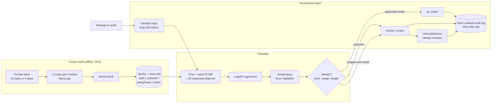

# LLM provenance classifier

Which AI assistant drafted this passage? A calibrated, abstaining model-attribution baseline with a
governance layer that never accuses anyone, built on a corpus generated on CPU by small open models.

## Recruiter summary

- **Problem:** a content-audit team at a fictional insurer, Quillmere Assurance, needs to know whether
  customer-facing text was drafted with an approved AI assistant, without ever blaming a person on a guess.
- **Approach:** 920 passages generated by five small open models (same prompts for every model, split
  by topic); TF-IDF + 32 stylometry features into logistic regression; temperature calibration; an
  "unknown model" abstain rule; robustness attacks (paraphrase, truncation, style copying, an unseen
  model); a guardrail layer that only ever says "statistically consistent with" and routes to a human.
- **Proof (measured on 160 unseen-topic test passages, synthetic data):** accuracy **66.2%**<!-- m:variants.full.accuracy.rate -->
  vs 25.0%<!-- m:majority_baseline.rate --> for the majority class; when it does attribute, it is right
  86.7%<!-- m:selective.accuracy_when_attributed.rate --> of the time, and only 5.0%<!-- m:selective.wrong_attribution.rate -->
  of all passages get a wrong name. A copied writing style still fools it on 26.2%<!-- m:robustness.style_mimic.fooled_into_mimicked_model.rate -->
  of attacks: that miss is reported, tested and handled by human review. 0<!-- m:guardrails.auto_accusations --> automatic
  accusations across 440<!-- m:guardrails.findings --> findings. <!-- tests -->90<!-- /tests --> tests, CI green.

## Purpose and who it is for

- **Content-audit and AI-governance teams** who must show which assistants produced customer text.
- **ML engineers** who want an honest, small, reproducible attribution baseline to beat.
- **Reviewers** of AI policy: the governance rules are code, with tests, not a slide.

It is a reference build on synthetic data. It is not a detector for large hosted models, and it never
decides whether a person broke a rule.

## Architecture



## How it works, step by step

1. **Prompts.** `provenance/prompts.py` makes 160 prompts (letters, FAQ answers, case notes, posts) on
   40 insurance topics. Topics are split 25 / 5 / 10 into train / validation / test by a hash.
2. **Generation.** Four "known" models answer every prompt; a fifth model answers only test prompts and
   plays the "unknown" assistant. A paraphraser rewrites every test passage, and two models are shown a
   passage by another model and told to copy its style. All on CPU with llama.cpp, temperature 0.7.
   See [docs/data-card.md](docs/data-card.md).
3. **Brand scrub.** Real consumer brand names the models invented in their answers (15 words in total)
   are swapped for made-up names (`scripts/scrub_corpus.py`).
4. **Features.** Character 2-5 grams and word 1-2 grams (TF-IDF) plus 32 stylometry features
   (sentence length, punctuation, list and markdown use, greetings, sign-offs, placeholders, emoji).
5. **Classifier.** Multinomial logistic regression (C = 10, set before looking at test).
6. **Calibration.** One temperature fitted on validation: 1.6<!-- m:calibration.temperature -->, cutting test ECE from
   0.135<!-- m:calibration.before.ece --> to 0.073<!-- m:calibration.after.ece -->.
7. **Abstain.** Attribute only if the calibrated top score is at least 0.70<!-- m:policy.min_prob -->, beats the runner-up
   by 0.175<!-- m:policy.min_margin -->, and the passage has 30+ words. Thresholds come from validation (target 95%
   precision); the unseen model is never used to tune them.
8. **Governance.** `provenance/guardrails.py` turns each result into a finding (rules below), and
   `run_eval.py` fails CI if any finding breaks them.

## Results (measured, synthetic corpus)

Full tables with Wilson 95% intervals and the confusion matrix: [results/report.md](results/report.md).

<!-- run: python scripts/run_eval.py --summary -->
```text
test passages: 160 (4 models x 40 unseen-topic prompts)
majority baseline: 0.250
accuracy full / tfidf / stylometry: 0.662 / 0.662 / 0.637
full 95% CI: 0.586-0.731
ECE before -> after temperature 1.6: 0.135 -> 0.073
coverage 0.375, accuracy when attributed 0.867
unknown model abstain rate: 0.800
paraphrase: raw accuracy 0.512, abstain 0.669
style_mimic: raw accuracy 0.237, abstain 0.662
truncate_25_words: raw accuracy 0.481, abstain 1.000
guardrails: 0 auto-accusations, lint pass 1.0
```
<!-- /run -->

What the numbers say, in plain words:

- **The style signal is real but modest.** Stylometry alone reaches 63.7%<!-- m:variants.stylometry.accuracy.rate -->;
  adding TF-IDF gives 66.2%<!-- m:variants.full.accuracy.rate --> (95% CI 58.6-73.1%). The hardest model is
  smollm2-360m (recall 52.5%<!-- m:per_model_recall.smollm2-360m.rate -->), often confused with qwen2.5-0.5b.
- **Abstaining trades coverage for safety.** It names a model for 37.5%<!-- m:selective.coverage.rate --> of passages and is right
  on 86.7% of those. The 95% target set on validation was **not** reached on test: a known gap.
- **The unseen model** is sent to "unknown" 80.0%<!-- m:unknown_model.abstained.rate --> of the time; 8 of 40 are forced into a known model.
- **Paraphrasing** drops raw accuracy to 51.2%<!-- m:robustness.paraphrase.raw_accuracy.rate -->; snippets of 25 words are always
  "unknown" (100.0%<!-- m:robustness.truncate_25_words.abstain.rate -->) by the length rule.
- **Style copying is the worst case:** raw accuracy 23.8%<!-- m:robustness.style_mimic.raw_accuracy.rate -->, and 26.2% of attacks are
  attributed to the model being copied.

## Real code and its real output

The governance rule that keeps findings non-accusatory (`provenance/guardrails.py`):

```python
ok = cand in approved_models
if ok:
    action = "no_action"
    wording = (f"The passage is statistically consistent with {cand}, an approved assistant "
               f"(score {conf:.2f}). No action needed.")
else:
    action = "human_review"
    reasons.append("candidate is not on the approved list")
    wording = (f"The passage is statistically consistent with {cand}, which is not on the approved list "
               f"(score {conf:.2f}). This is a statistical signal, not a finding about any person. "
               f"A reviewer should talk to the author before drawing any conclusion.")
```

One audit batch, end to end:

<!-- run: python examples/audit_demo.py -->
```text
model: temperature 1.6, abstain if top < 0.7 or margin < 0.175 or words < 30

[approved assistant] status=consistent_with candidate=smollm2-1.7b score=0.81 action=no_action
  reasons: attributed
  wording: The passage is statistically consistent with smollm2-1.7b, an approved assistant (score 0.81). No action needed.

[unapproved assistant] status=consistent_with candidate=smollm2-360m score=0.82 action=human_review
  reasons: attributed; candidate is not on the approved list
  wording: The passage is statistically consistent with smollm2-360m, which is not on the approved list (score 0.82). This is a statistical signal, not a finding about any person. A reviewer should talk to the author before drawing any conclusion.
  human decision recorded: coaching by R. Okafor (content audit)

[short snippet] status=inconclusive candidate=None score=0.47 action=human_review
  reasons: too short (18 words < 30)
  wording: Inconclusive: the passage does not match any assistant we track closely enough (top score 0.47). A reviewer may look at it; no conclusion has been drawn.

[self-claim injected] status=inconclusive candidate=None score=0.67 action=human_review
  input note: removed a line that claims who wrote the text
  reasons: low confidence (0.67 < 0.70)
  wording: Inconclusive: the passage does not match any assistant we track closely enough (top score 0.67). A reviewer may look at it; no conclusion has been drawn.

audit log: 5 rows, hash chain valid = True, raw text stored = False
```
<!-- /run -->

## How to run

Offline, no cloud, no model weights needed (the corpus is committed):

```bash
python -m venv .venv && . .venv/bin/activate
pip install -r requirements.txt
python -m pytest -q                       # tests
python scripts/run_eval.py                # all metrics -> results/
python examples/audit_demo.py             # one audit batch
python -m provenance.cli --text "Dear customer, ..."
```

Regenerate the corpus (optional, about 3.7 GB of Apache-2.0 weights, roughly an hour on 8 CPU cores):

```bash
pip install llama-cpp-python==0.3.36
bash scripts/fetch_models.sh
python scripts/generate_corpus.py --job all
```

Optional transformer fine-tune (off, written but not run): `PROVENANCE_FINETUNE=1 python -m provenance.finetune`
after installing `torch` and `transformers`.

Optional cloud: Microsoft Foundry / Azure ML managed online endpoint, Terraform and Bicep, gated off.
See [docs/deployment.md](docs/deployment.md) for the resource list and a dated cost estimate.

## Guardrails and security controls

| Control | Where |
|---|---|
| Only `no_action` or `human_review` can happen automatically | `guardrails.review`, CI eval gate |
| Low confidence, short text or close runner-up -> "unknown" -> human | `abstain.AbstainPolicy` |
| Wording lint blocks accusatory words ("proves", "cheated", "was written by" ...) | `guardrails.lint_wording` |
| Adverse outcomes need a named human reviewer and a written rationale | `guardrails.HumanDecision` |
| Hash-chained audit log, SHA-256 of the passage only | `guardrails.AuditLog` |
| Self-claims ("this was written by ...") stripped before scoring | `guardrails.sanitize` |
| Input capped at 20,000 characters; errors never echo text | `guardrails`, `corpus` |
| No pickle loading: the model retrains from the committed corpus | `cli.default_model`, `infra/aml/score.py` |
| Endpoint needs Entra ID tokens; deploy is OIDC, manual and gated | `infra/`, `.github/workflows/deploy.yml` |
| CI: ruff, tests, eval gate, docs drift, brand check, gitleaks, CodeQL, IaC scans | `.github/workflows/` |

Threat model (STRIDE and OWASP LLM Top 10): [docs/threat-model.md](docs/threat-model.md).

## Limitations and known failures

- **Style copying fools it** (26.2% of attacks). Kept as a test: `test_known_miss_style_mimic_fools_the_classifier`.
- **The unseen model is not always caught** (8 of 40). Test: `test_known_miss_out_of_set_model_sometimes_forced_into_known`.
- **Test precision is below the validation target** (86.7% vs 95%). Test: `test_known_gap_test_precision_below_validation_target`.
- Some passages name their own model ("I am Qwen"); 9 of 640 in the main corpus. This is an easy signal
  that real text would rarely have.
- Small models, one domain, English, one sampling setting, 160 test passages: wide intervals, and the
  numbers say nothing about large hosted models or text a person has edited heavily.
- Generation on other CPUs or llama.cpp builds can differ slightly; the committed corpus is what was measured.

## Built vs planned

| Item | Status |
|---|---|
| Reproducible corpus generator (5 open models, CPU) and the 920-passage corpus | Built |
| Brand scrub with hashed list | Built |
| TF-IDF + stylometry baseline, ablation, calibration, abstain | Built |
| Robustness: truncation, formatting strip, greeting/sign-off removal, paraphrase, style copy, unseen model | Built |
| Eval with confusion matrix and Wilson intervals; CI eval gate | Built |
| Governance layer, human decisions, hash-chained audit log, CLI | Built |
| Azure ML scoring script (unit-tested offline) | Built |
| Terraform + Bicep for Microsoft Foundry / Azure ML endpoint, deploy workflow | Written, not run (gated off) |
| Small transformer fine-tune behind a flag | Written, not run |
| Private networking, prod stage, teardown workflow | Planned |
| Larger or hosted models, human-edited text, other languages | Planned |

## Docs

- [Data card](docs/data-card.md) and [model card](docs/model-card.md)
- [Implementation guide](docs/implementation-guide.md) for teams adopting this
- [Interview points](docs/interview-points.md)
- [Threat model](docs/threat-model.md), [deployment](docs/deployment.md), [ADRs](docs/adr/)

## Related repos

- [Jagadish-agentic-ai-model-risk](https://github.com/jagadishmazure-jpg/Jagadish-agentic-ai-model-risk): model risk cards and HITL sign-off; this repo is one model that would sit in that inventory.
- [Jagadish-llm-evals-observability](https://github.com/jagadishmazure-jpg/Jagadish-llm-evals-observability): eval gates and tracing for LLM apps.
- [Jagadish-enterprise-ai-trust-pack](https://github.com/jagadishmazure-jpg/Jagadish-enterprise-ai-trust-pack): AI trust and governance controls.
- [Jagadish-agent-eval-studio](https://github.com/jagadishmazure-jpg/Jagadish-agent-eval-studio): evaluation with confidence intervals for agents.

## License

MIT. Generated passages come from Apache-2.0 models; weights are not included.
