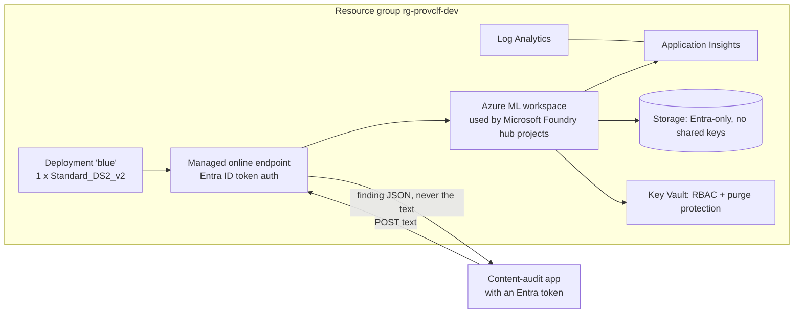

# Deployment to Microsoft Foundry / Azure ML (written, not run)

Nothing here has been deployed. The IaC is validated in CI (`terraform validate` and `test` with
mocked providers, `tflint`, `checkov`, `bicep build`), and the deploy workflow is switched off.

## What would be created

| Resource | Terraform | Bicep |
|---|---|---|
| Log Analytics + Application Insights | `azurerm_log_analytics_workspace`, `azurerm_application_insights` | same ARM types |
| Storage (TLS 1.2, no shared keys, no public blobs) | `azurerm_storage_account` | `Microsoft.Storage/storageAccounts` |
| Key Vault (RBAC, purge protection) | `azurerm_key_vault` | `Microsoft.KeyVault/vaults` |
| Azure ML workspace (identity access to storage) | `azapi_resource` (2025-06-01) | `workspaces@2025-06-01` |
| Managed online endpoint (`AADToken`) | `azapi_resource` | `onlineEndpoints@2025-06-01` |
| Diagnostic settings (workspace, Key Vault) | `azurerm_monitor_diagnostic_setting` | `diagnosticSettings` |

The model deployment is created by `az ml online-deployment create -f infra/aml/deployment.yml`. The
scoring script `infra/aml/score.py` retrains the baseline from the corpus in the code asset at start-up
(no pickle), and returns only the governance finding. It is unit-tested offline (`tests/test_score.py`).

## Cost before anyone says yes

The only always-on cost is the deployment VM: **Standard_DS2_v2, Linux, eastus2, $0.114 per hour**
(Azure Retail Prices API, pay-as-you-go, checked 2026-11-09), about **$83 for a 730-hour month**.
Log Analytics, storage and Key Vault add a small amount at demo volumes. Delete the resource group to
stop all charges. Do not enable the workflow without checking current prices and getting approval.

## One-time setup (only if approved)

1. Create an Entra app registration with a federated credential for this repo's `dev` environment.
2. Give it Contributor on one subscription or resource group.
3. Set repository variables `AZURE_CLIENT_ID`, `AZURE_TENANT_ID`, `AZURE_SUBSCRIPTION_ID`.
4. Add a required reviewer to the `dev` environment.
5. Set `DEPLOY_ENABLED=true` and run **deploy** by hand.

## Planned, not built

Private endpoints and a VNet for storage, Key Vault and the workspace (skipped in `.checkov.yaml`
with reasons), a `prod` stage, and a teardown workflow.
